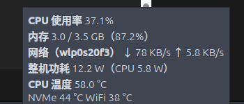

# LXQt 系统监视面板（lxqt-sysmon）

> 在 LXQt 任务栏上用一行正常字号的文字，显示 CPU、内存、实时网速、整机功耗和 CPU 温度。
> 替代只能放 3～4 个字符的 22×22 托盘数字图标（`C98 M82 22K` 那种）。

<p align="center">
  
</p>

```
CPU 37% │ 内存 87% │ ↓ 88 KB/s ↑ 5.9 KB/s │ 12 W │ 57°C
```

鼠标悬停可看详情：

<p align="center">
  
</p>

## 功能

- **CPU 使用率**：`/proc/stat` 两次采样求差（扣除 idle 和 iowait）
- **内存占用**：`/proc/meminfo` 的 `MemTotal` 与 `MemAvailable`
- **实时网速**：默认路由接口，分别显示 ↓ / ↑
- **整机功耗**：Intel RAPL `psys` 域，缺失时回退 `package-0`（仅 CPU 封装）
- **CPU 温度**：`coretemp` 的 Package 传感器，缺失时回退 `acpitz`
- **悬停详情**：内存已用/总量（GB）、功耗拆分（整机 / CPU）、NVMe 与 WiFi 温度
- **按需变色**：负载正常时保持面板文字色，超过阈值才变橙 / 红；浅色主题自动换深色色值
- **宽度稳定**：面板宽度由最坏情况固定，数值位数变化时不会抖动
- **零依赖**：只读 `/proc` 和 `/sys`，不需要额外守护进程，不需要 root

支持 LXQt 1.4+（Qt 5），已在 Ubuntu 24.04 / LXQt 1.4 / Qt 5.15 上测试。

## 一键安装

```bash
git clone https://github.com/hacksmo/lxqt-sysmon.git
cd lxqt-sysmon
./install.sh
```

安装脚本会自己编译，把文件装到用户目录，把插件加进面板配置，然后重启面板。
**全程不需要 sudo**，装完立刻就能在任务栏看到。

### 依赖

| 发行版 | 安装命令 |
| --- | --- |
| Ubuntu / Debian | `sudo apt install build-essential qtbase5-dev lxqt-panel` |
| Arch / Manjaro | `sudo pacman -S base-devel qt5-base lxqt-panel` |
| Fedora | `sudo dnf install gcc-c++ qt5-qtbase-devel lxqt-panel-devel` |

> `qmake` 和 Qt5 Widgets 头文件来自 `qtbase5-dev`；
> `ilxqtpanelplugin.h` 由 `lxqt-panel` 包提供（部分发行版在 `-devel` 包里）。

### 安装脚本做了什么

1. 在 `build/` 里执行 `qmake && make` 编译出 `libsysmon.so`
2. 安装插件库到 `~/.local/lib/lxqt-panel/libsysmon.so`
3. 安装插件描述到 `~/.local/share/lxqt/lxqt-panel/sysmon.desktop`
4. 在 `~/.config/lxqt/session.conf` 的 `[Environment]` 写入
   `LXQTPANEL_PLUGIN_PATH=~/.local/lib/lxqt-panel`
   （LXQt 面板只搜索编译期目录和这个环境变量，没有 root 时只能走后者）
5. 在 `~/.config/autostart/lxqt-panel.desktop` 的 `Exec` 前也加上同一个环境变量（双保险）
6. 在 `~/.config/lxqt/panel.conf` 的插件列表里插入 `sysmon`（优先放在 `taskbar` 之后），
   并补上 `[sysmon]` 段
7. 重启 `lxqt-panel`

改动前会自动备份，后缀 `.bak-sysmon`。想先看看脚本做什么，可以直接读
[`install.sh`](install.sh)。

常用选项：

```bash
./install.sh --no-restart          # 不动正在运行的面板，装完自己重启
LXQTPANEL_PLUGIN_DIR=/some/dir ./install.sh   # 装到别的插件目录
```

## 显示说明

| 字段 | 数据来源 | 回退 | 变色阈值 |
| --- | --- | --- | --- |
| CPU | `/proc/stat` | — | 70% / 90% |
| 内存 | `/proc/meminfo` | — | 80% / 92% |
| 网速 | `/proc/net/route` + `/proc/net/dev` | — | 固定蓝色 |
| 功耗 | RAPL `psys` | RAPL `package-0` | 20 W / 35 W |
| 温度 | `coretemp` Package | `acpitz` | 60 °C / 75 °C |

- 每秒采样一次；网速是两次采样之间的平均速率。
- CPU / 内存 / 功耗按模板定宽（`100%`、`15 W`），数字变化时面板宽度不变。
- 功耗按 `15 W` 预留宽度，超过 99 W 时显示为 `99 W`；换到高功耗机器可把
  `sysmonplugin.cpp` 里的模板改成 `999 W`。

## 自定义

都在 [`sysmonplugin.cpp`](sysmonplugin.cpp) 里：

| 想改什么 | 位置 |
| --- | --- |
| 刷新间隔 | `startTimer(1000)` |
| 变色阈值 | `buildFields()` 里的 `mCpuPct < 70`、`mTemp < 60` 等 |
| 配色 | `buildFields()` 开头的 `warn` / `hot` / `net` / `good` |
| 字段宽度 | `buildFields()` 里的 `f.templ`、`piece(..., "999 KB/s", true)` |
| 字段顺序 / 增删 | `buildFields()` 里的字段块 |

改完执行：

```bash
cd ~/.local/src/lxqt-sysmon
mkdir -p build && (cd build && qmake .. && make -j4)
cp build/libsysmon.so ~/.local/lib/lxqt-panel/
pkill -9 -x lxqt-panel; sleep 1
setsid env LXQTPANEL_PLUGIN_PATH=$HOME/.local/lib/lxqt-panel lxqt-panel >/dev/null 2>&1 &
```

也可以右键任务栏 → **面板设置 → 小组件**，在里面调整位置或移除。

## 卸载

```bash
./uninstall.sh
```

会删除插件文件，并从 `session.conf`、自启项和 `panel.conf` 里撤销 `sysmon`，然后重启面板。
同样支持 `--no-restart`。

## 手动安装

不想用脚本时，等价步骤：

```bash
# 编译（在 build/ 里做影子构建，不污染源码目录）
mkdir -p build && (cd build && qmake .. && make -j4)

# 安装
install -Dm755 build/libsysmon.so ~/.local/lib/lxqt-panel/libsysmon.so
install -Dm644 sysmon.desktop   ~/.local/share/lxqt/lxqt-panel/sysmon.desktop

# 让面板能找到插件
export LXQTPANEL_PLUGIN_PATH=$HOME/.local/lib/lxqt-panel
# 并把这一行写进 ~/.config/lxqt/session.conf 的 [Environment] 组

# 在 ~/.config/lxqt/panel.conf 的 [panel1] 里把 sysmon 加进 plugins=
# plugins=mainmenu, desktopswitch, quicklaunch, showdesktop, taskbar, sysmon, mount, tray, statusnotifier, worldclock

# 重启面板
pkill -x lxqt-panel; sleep 1
setsid env LXQTPANEL_PLUGIN_PATH=$HOME/.local/lib/lxqt-panel lxqt-panel >/dev/null 2>&1 &
```

## 开发

```
sysmonplugin.h/.cpp   插件实现（采样 + 绘制 + tooltip）
sysmon.pro            qmake 工程
sysmon.desktop        插件描述文件
install.sh            一键安装
uninstall.sh          卸载
docs/                 README 截图
testload.cpp          不启动面板、单独预览小组件的调试程序
```

单独预览（不用重装面板）：

```bash
mkdir -p build && (cd build && qmake .. && make -j4)
g++ -fPIC -std=c++17 testload.cpp -o build/testload \
    $(pkg-config --cflags --libs Qt5Widgets) -I/usr/include/lxqt -I.
./build/testload
```

## 已知限制

- **网速按默认路由接口统计**：开 VPN / Tailscale 时可能统计到 VPN 接口，而不是物理网卡。
- **功耗精度**：只有 `package-0` 的机器上显示的是 CPU 封装功耗，不是整机功耗。
- **只显示总量**：不区分进程、连接或流量类型。
- **仅 Linux**：依赖 `/proc`、`/sys` 和 RAPL / hwmon。

## 相关项目

同一台机器上的其他小工具记录在开发日记里：`~/Desktop/开发日记/`。
